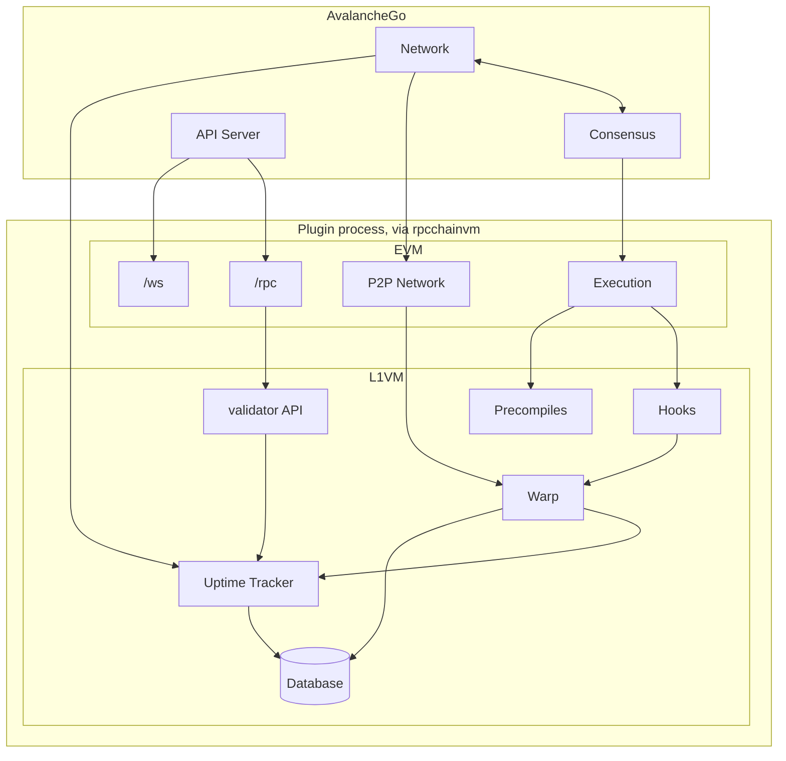

# L1 VM (`l1s`)

`l1s` is the EVM for Avalanche L1s. It is a chain-specific harness around the [EVM framework](../../README.md), which implements [ACP-194](https://github.com/avalanche-foundation/ACPs/tree/main/ACPs/194-continuous-execution). The framework handles block execution, settlement, gas accounting, and EVM gossip. `l1s` adds what lets an L1 owner shape their chain, precompiles that gate transactions and deployment, route rewards, mint the native token, and set gas pricing. It also adds Warp messaging and validator uptime attestations.

`l1s` builds blocks only from the Igloo network upgrade onward. It must still parse and execute earlier blocks with their original rules, so an existing L1 keeps its history.

## Table of contents

- [Scope](#scope)
- [Architecture](#architecture)
  - [Hooks](#hooks)
- [Precompiles](#precompiles)
  - [Allow lists](#allow-lists)
- [Genesis format](#genesis-format)
  - [Top-level fields](#top-level-fields)
  - [Chain config fields](#chain-config-fields)
  - [Precompile config fields](#precompile-config-fields)
- [Upgrade format](#upgrade-format)
- [How it works](#how-it-works)
  - [Which state each decision reads](#which-state-each-decision-reads)
  - [Header extensions](#header-extensions)
  - [Precompile enforcement](#precompile-enforcement)
- [Behavior changes at Igloo](#behavior-changes-at-igloo)
- [References](#references)

## Scope

`l1s` shares the EVM framework with the [C-Chain VM](../cchain/README.md) but none of its C-Chain-only behavior. There are no cross-chain transactions, no Primary Network shared memory, no `/avax` API, and no extra block body fields.

Like the C-Chain, validators vote on the [ACP-176](https://github.com/avalanche-foundation/ACPs/tree/main/ACPs/176-dynamic-evm-gas-limit-and-price-discovery-updates) gas target and the [ACP-226](https://github.com/avalanche-foundation/ACPs/tree/main/ACPs/226-dynamic-minimum-block-times) minimum block delay. Unlike the C-Chain, an L1 owner can pin gas pricing with the gas price manager precompile, as specified by [ACP-224](https://github.com/avalanche-foundation/ACPs/tree/main/ACPs/224-dynamic-gas-limit-in-subnet-evm).

## Architecture

An L1 chain is composed of three major components.

1. **AvalancheGo.** [Networking](../../../../network), [consensus](../../../../snow), validator-set management, and the external API surface.
2. **EVM.** The generic EVM implementation, [`vms/evm`](../../).
3. **L1.** This package, which adds L1-specific behavior.

The EVM and L1 always run together as a separate plugin process. AvalancheGo talks to it over gRPC through [`rpcchainvm`](../../../rpcchainvm), so every arrow from AvalancheGo below crosses a process boundary.



The uptime tracker records when each validator of this L1 is connected. Warp uses it to sign validator uptime attestations, and the `validator` API serves it.

### Hooks

Hooks are the seam through which the EVM calls into L1-specific code at each stage of a block's life.

- **Build.** Construct the header, choose the fee recipient, stamp gas pricing, and record Warp predicate results.
- **Admit.** Reject transactions from senders the transaction allow list excludes.
- **Execute.** Apply precompile activations and state upgrades scheduled since the parent block.
- **After execution.** Store emitted Warp messages so validators can sign them.

## Precompiles

Each precompile is a contract at a fixed address, activated by its config key in genesis or in an upgrade. Each name links to the contract's Solidity interface.

| Precompile | Address | Config key | Purpose |
| --- | --- | --- | --- |
| [Contract deployer allow list](../../../../graft/subnet-evm/precompile/allowlist/IAllowList.sol) | `0x0200000000000000000000000000000000000000` | `contractDeployerAllowListConfig` | Restricts who may deploy contracts. |
| [Native minter](../../../../graft/subnet-evm/precompile/contracts/nativeminter/INativeMinter.sol) | `0x0200000000000000000000000000000000000001` | `contractNativeMinterConfig` | Mints the native token. |
| [Transaction allow list](../../../../graft/subnet-evm/precompile/allowlist/IAllowList.sol) | `0x0200000000000000000000000000000000000002` | `txAllowListConfig` | Restricts who may send transactions. |
| [Fee manager](../../../../graft/subnet-evm/precompile/contracts/feemanager/IFeeManager.sol) | `0x0200000000000000000000000000000000000003` | `feeManagerConfig` | Retired at Igloo. Rejected in new configurations. |
| [Reward manager](../../../../graft/subnet-evm/precompile/contracts/rewardmanager/IRewardManager.sol) | `0x0200000000000000000000000000000000000004` | `rewardManagerConfig` | Chooses who receives transaction tips. |
| [Warp](../../../../graft/subnet-evm/precompile/contracts/warp/warpbindings/IWarpMessenger.sol) | `0x0200000000000000000000000000000000000005` | `warpConfig` | Sends and verifies Warp messages. |
| [Gas price manager](../../../../graft/subnet-evm/precompile/contracts/gaspricemanager/IGasPriceManager.sol) | `0x0200000000000000000000000000000000000006` | `gasPriceManagerConfig` | Sets ACP-224 gas pricing. |

### Allow lists

Every precompile except Warp is gated by its own allow list, using the [`IAllowList`](../../../../graft/subnet-evm/precompile/allowlist/IAllowList.sol) interface.

- **Admin.** Assigns any role and calls the precompile.
- **Manager.** Grants and revokes the Enabled role and calls the precompile.
- **Enabled.** Calls the precompile.

For the two allow-list precompiles, calling means deploying a contract or sending a transaction.

## Genesis format

Genesis is a JSON object. This section covers chains whose genesis timestamp is at or after Igloo. The example activates every precompile except the retired fee manager.

```json
{
  "config": {
    "chainId": 99999,
    "allowFeeRecipients": true,
    "initialMinDelayMS": 1000,
    "contractDeployerAllowListConfig": {
      "blockTimestamp": 1778384896,
      "adminAddresses": ["0x8db97C7cEcE249c2b98bDC0226Cc4C2A57BF52FC"],
      "enabledAddresses": ["0x1111111111111111111111111111111111111111"]
    },
    "contractNativeMinterConfig": {
      "blockTimestamp": 1778384896,
      "adminAddresses": ["0x8db97C7cEcE249c2b98bDC0226Cc4C2A57BF52FC"],
      "initialMint": {
        "0x2222222222222222222222222222222222222222": "0xDE0B6B3A7640000"
      }
    },
    "txAllowListConfig": {
      "blockTimestamp": 1778384896,
      "adminAddresses": ["0x8db97C7cEcE249c2b98bDC0226Cc4C2A57BF52FC"],
      "managerAddresses": ["0x1111111111111111111111111111111111111111"]
    },
    "rewardManagerConfig": {
      "blockTimestamp": 1778384896,
      "adminAddresses": ["0x8db97C7cEcE249c2b98bDC0226Cc4C2A57BF52FC"],
      "initialRewardConfig": {
        "allowFeeRecipients": false,
        "rewardAddress": "0x3333333333333333333333333333333333333333"
      }
    },
    "gasPriceManagerConfig": {
      "blockTimestamp": 1778384896,
      "adminAddresses": ["0x8db97C7cEcE249c2b98bDC0226Cc4C2A57BF52FC"],
      "initialGasPriceConfig": {
        "validatorTargetGas": false,
        "targetGas": 2000000,
        "staticPricing": false,
        "minGasPrice": 1000000000,
        "timeToDouble": 60
      }
    },
    "warpConfig": {
      "blockTimestamp": 1778384896,
      "quorumNumerator": 67,
      "requirePrimaryNetworkSigners": false
    }
  },
  "timestamp": "0x6a000000",
  "gasLimit": "0x7a1200",
  "difficulty": "0x0",
  "alloc": {
    "0x8db97C7cEcE249c2b98bDC0226Cc4C2A57BF52FC": {
      "balance": "0x52B7D2DCC80CD2E4000000"
    }
  }
}
```

### Top-level fields

| Field | Meaning |
| --- | --- |
| `config` | Chain config. Required. See [Chain config fields](#chain-config-fields). |
| `timestamp` | Genesis time in seconds. |
| `alloc` | Initial accounts, keyed by address. Each sets `balance`, and optionally `code`, `storage`, and `nonce`. |
| `gasLimit` | Gas limit of the genesis header. Later blocks compute their own. |
| `coinbase`, `difficulty`, `extraData`, `mixHash`, `nonce` | Copied into the genesis header. They affect only its hash. |
| `number`, `gasUsed`, `parentHash` | Must be zero or omitted. |
| `excessBlobGas`, `blobGasUsed` | Must be omitted. |

### Chain config fields

| Field | Meaning |
| --- | --- |
| `chainId` | EIP-155 chain ID. Required. |
| `allowFeeRecipients` | If true, tips go to each block builder's configured `fee-recipient`. If false, tips are burned. The reward manager overrides this while active. |
| `initialMinDelayMS` | ACP-226 minimum block delay at genesis, in milliseconds. Zero uses the ACP-226 default. |
| `subnetEVMTimestamp`, `durangoTimestamp`, `etnaTimestamp`, `fortunaTimestamp`, `graniteTimestamp`, `heliconTimestamp`, `iglooTimestamp` | Network upgrade times in seconds. Omitted or zero follows the Primary Network schedule. A later time delays the upgrade. An earlier time is rejected. |
| Precompile config keys | Activate precompiles. See [Precompile config fields](#precompile-config-fields). |

Ethereum fork fields such as `londonBlock` and `cancunTime` are derived from the network upgrade times and need not be set.

### Precompile config fields

Every precompile config has these fields.

| Field | Meaning |
| --- | --- |
| `blockTimestamp` | Activation time in seconds. Use the genesis `timestamp` to activate at genesis. Required. |
| `disable` | Deactivates the precompile. Only valid in [upgrades](#upgrade-format). |

Every precompile except Warp also has allow list fields. An address may appear in at most one list.

| Field | Meaning |
| --- | --- |
| `adminAddresses` | Addresses granted the Admin role at activation. |
| `managerAddresses` | Addresses granted the Manager role at activation. |
| `enabledAddresses` | Addresses granted the Enabled role at activation. |

The deployer and transaction allow lists have no other fields. The rest follow.

#### `contractNativeMinterConfig`

| Field | Meaning |
| --- | --- |
| `initialMint` | Map from address to amount, in wei, minted at activation. Amounts must be positive. |

#### `rewardManagerConfig`

`initialRewardConfig` sets where tips go at activation. If omitted, the chain's `allowFeeRecipients` applies.

| Field | Meaning |
| --- | --- |
| `allowFeeRecipients` | If true, tips go to each block builder's configured `fee-recipient`. |
| `rewardAddress` | If set, tips go to this address. |

Setting both is rejected. Setting neither burns tips.

#### `gasPriceManagerConfig`

The gas price manager is introduced at Igloo, so `blockTimestamp` must not precede it.

`initialGasPriceConfig` sets ACP-224 pricing at activation. The defaults apply when it is omitted, and on chains without the gas price manager.

| Field | Meaning | Default |
| --- | --- | --- |
| `validatorTargetGas` | If true, validators vote on the gas target. | `true` |
| `targetGas` | Gas target per second. Zero when validators vote, otherwise at least 1,000,000. | `0` |
| `staticPricing` | If true, the gas price is fixed at `minGasPrice`. | `false` |
| `minGasPrice` | Minimum gas price in wei. Must be positive. | `1` |
| `timeToDouble` | Seconds for the gas price to double under sustained full blocks. Zero when pricing is static, otherwise positive. | `60` |

#### `warpConfig`

| Field | Meaning |
| --- | --- |
| `quorumNumerator` | Percentage of stake that must sign an inbound message. Zero means 67. Otherwise between 33 and 100. |
| `requirePrimaryNetworkSigners` | If true, messages from Primary Network chains other than the P-Chain must be signed by Primary Network validators. If false, this L1's validators suffice. |

## Upgrade format

Upgrade bytes are a JSON object that changes the chain after genesis.

```json
{
  "networkUpgradeOverrides": {
    "iglooTimestamp": 1778384896
  },
  "precompileUpgrades": [
    {
      "txAllowListConfig": {
        "blockTimestamp": 1780000000,
        "disable": true
      }
    },
    {
      "txAllowListConfig": {
        "blockTimestamp": 1781000000,
        "adminAddresses": ["0x1111111111111111111111111111111111111111"]
      }
    }
  ],
  "stateUpgrades": [
    {
      "blockTimestamp": 1782000000,
      "accounts": {
        "0x8db97C7cEcE249c2b98bDC0226Cc4C2A57BF52FC": {
          "balanceChange": "0xDE0B6B3A7640000",
          "storage": {
            "0x0000000000000000000000000000000000000000000000000000000000000000": "0x0000000000000000000000000000000000000000000000000000000000000001"
          }
        }
      }
    }
  ]
}
```

- **`networkUpgradeOverrides`.** Network upgrade times that replace those in genesis. The same rules apply.
- **`precompileUpgrades`.** A list of objects, each with exactly one precompile config key. Every config requires `blockTimestamp`. Times must not decrease across the list and must strictly increase for a single precompile. Each precompile must alternate between enabling and disabling, starting from its genesis state. Disabling wipes the precompile's storage, so re-enabling starts from the new config.
- **`stateUpgrades`.** A list of `{blockTimestamp, accounts}` objects. Every object requires `blockTimestamp`, and times must be non-zero and strictly increasing. For each account, `code` replaces its code, `storage` sets the given slots, and `balanceChange` is added to its balance.

An upgrade applies when the first block at or past its time executes. Once a node has accepted such a block, the upgrade can no longer be changed or removed. A node given incompatible upgrade bytes refuses to start.

## How it works

### Which state each decision reads

Under continuous execution, a block is built before its parent finishes executing. Anything that affects block validity must therefore read state every verifier can reproduce.

- **Settled state.** Fee recipient routing and worst-case transaction admission read settled state.
- **Last-executed state.** Mempool admission reads the latest executed state. It only filters what enters the pool, so it need not be reproducible.
- **Parent header.** Gas pricing for a block comes from the configuration stamped in its parent's header. Replay and verification never reopen historical state to price a block.

### Header extensions

From Igloo onward, each header carries the settlement marker, the ACP-176 target, the ACP-226 delay excess, and the ACP-224 gas configuration. Pre-Igloo headers omit these fields, so their encodings and hashes are unchanged.

When the gas price manager is active, the builder reads its configuration from settled state and stamps it into the header. Before the first stamped header, the genesis configuration applies.

### Precompile enforcement

The transaction allow list is enforced at admission, because a disallowed transaction makes its block invalid. The contract deployer allow list is enforced inside EVM execution, so contracts created by other contracts follow the same rules as top-level deployments.

## Behavior changes at Igloo

Existing L1s see the following changes when they reach Igloo.

- **The fee manager is retired.** Configurations at or after Igloo are rejected, or removed when immutable genesis contains them. If the precompile was active, its state is wiped at Igloo. Pricing then comes from ACP-176 and ACP-224. The pre-Igloo fee configuration is still validated so historical blocks verify.
- **Base fees are burned.** The fee recipient receives only the effective tip, matching Ethereum after London. Previously it received the full effective gas price. This change is intentional.
- **Operator configuration is smaller.** See [config.md](config.md) for supported options and how deprecated ones are converted.

## References

- [config.md](config.md). Node operator configuration.
- [EVM framework](../../README.md). Execution, settlement, and the hook interface.
- [C-Chain VM](../cchain/README.md). The other chain built on the framework.
- [`rpcchainvm`](../../../rpcchainvm). The gRPC plugin boundary between AvalancheGo and this VM.
- [`dynamic`](../dynamic). ACP-176 and ACP-226 math shared with the C-Chain.
- [ACP-194](https://github.com/avalanche-foundation/ACPs/tree/main/ACPs/194-continuous-execution). Continuous execution.
- [ACP-176](https://github.com/avalanche-foundation/ACPs/tree/main/ACPs/176-dynamic-evm-gas-limit-and-price-discovery-updates). Dynamic gas target.
- [ACP-224](https://github.com/avalanche-foundation/ACPs/tree/main/ACPs/224-dynamic-gas-limit-in-subnet-evm). Owner-set gas pricing.
- [ACP-226](https://github.com/avalanche-foundation/ACPs/tree/main/ACPs/226-dynamic-minimum-block-times). Dynamic minimum block delay.
