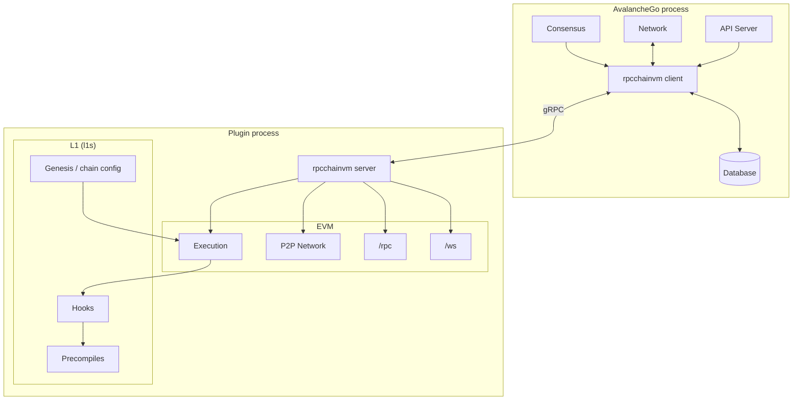

# L1 VM (`l1s`)

`l1s` is a thin harness around the EVM framework, in the same way as [`cchain`](../cchain/README.md). The framework does the heavy lifting of block execution, settlement, gas accounting, and EVM gossip. `l1s` adds what makes a chain *an L1*: a user-supplied genesis and upgrade schedule, configurable fees, and a set of optional stateful precompiles.

Unlike the C-Chain, there is no single L1. Each L1 is its own chain, configured by its creator, and most behavior is selected through [chain configuration](#chain-configuration) rather than code.

## Table of contents

- [Architecture](#architecture)
- [Chain configuration](#chain-configuration)
- [Precompiles](#precompiles)
- [References](#references)

## Architecture

An L1 is composed of the following components:

1. **AvalancheGo** — [networking](../../../../network), [consensus](../../../../snow), validator-set management, and the external API surface.
2. **rpcchainvm** — the gRPC bridge that lets AvalancheGo drive a VM running in a separate process.
3. **Plugin** — the VM binary that AvalancheGo launches as a subprocess.
4. **EVM** — the generic EVM implementation ([`vms/evm`](../../)).
5. **L1** (this package) — the wrapper that adds L1-specific behavior.

### Plugin and rpcchainvm

L1 VMs are not linked into AvalancheGo. They are built as standalone plugin binaries and loaded by the node at runtime through [`rpcchainvm`](../../../rpcchainvm).



TODO: add details about Warp to the diagram, like uptime and transfers.

### Block format

TODO: document the block header differences from upstream Ethereum, and which fields are present depending on which network upgrades are active (e.g. `blockGasCost` after Etna, `timestampMilliseconds` and `minDelayExcess` after Granite, settlement fields once SAE rules apply).

## Chain configuration

An L1 is configured by three byte strings that AvalancheGo passes to the VM on `Initialize`:

| Input          | Source                                              | Mutable after creation?                        | Purpose                                                                                       |
| -------------- | --------------------------------------------------- | ---------------------------------------------- | --------------------------------------------------------------------------------------------- |
| `genesisBytes` | Chain creation transaction on the P-Chain           | No (the genesis block hash is checked)         | Initial state and the base chain config.                                                      |
| `upgradeBytes` | `upgrade.json` in the node's chain config directory | Yes, per-node, subject to compatibility checks | Scheduled changes: network upgrade overrides, precompile (de)activations, and state upgrades. |
| `configBytes`  | `config.json` in the node's chain config directory  | Yes, per-node                                  | Node operator settings (APIs, caches, mempool, etc.).                                         |

> `configBytes` has its own documentation. See TODO ADD LINK.

The genesis and upgrade bytes are combined into a single [`params.ChainConfig`](../../../../graft/subnet-evm/params/extras/config.go). Parsing and validation live in [`genesis.go`](genesis.go).

### How to write a genesis

The genesis is a JSON-encoded [`core.Genesis`](https://github.com/ava-labs/libevm/blob/main/core/genesis.go) with the L1-specific settings added to its `config` object. It is passed to the chain creation transaction and cannot be changed afterwards: the VM refuses to start if the genesis block hash differs from the one it stored on first launch.

#### Example

A minimal genesis with the default fee settings, Warp and the Native Minter enabled, and one funded account:

```json
{
  "config": {
    "chainId": 99999,
    "feeConfig": {
      "gasLimit": 15000000,
      "targetBlockRate": 2,
      "minBaseFee": 25000000000,
      "targetGas": 15000000,
      "baseFeeChangeDenominator": 36,
      "minBlockGasCost": 0,
      "maxBlockGasCost": 1000000,
      "blockGasCostStep": 200000
    },
    "warpConfig": {
      "blockTimestamp": 1700000000
    },
    "contractNativeMinterConfig": {
      "blockTimestamp": 1700000000,
      "adminAddresses": ["0x8db97C7cEcE249c2b98bDC0226Cc4C2A57BF52FC"],
      "initialMint": {
        "0x8db97C7cEcE249c2b98bDC0226Cc4C2A57BF52FC": "0x52B7D2DCC80CD2E4000000"
      }
    }
  },
  "timestamp": "0x6553f100",
  "gasLimit": "0xe4e1c0",
  "difficulty": "0x0",
  "alloc": {
    "8db97C7cEcE249c2b98bDC0226Cc4C2A57BF52FC": {
      "balance": "0x52B7D2DCC80CD2E4000000"
    }
  }
}
```

#### Fields

The genesis is a JSON object. Nested `config` settings are written `config.<name>`.

| Field                                       | Required | Notes                                                                                                                                                                                                                                                                                             |
| ------------------------------------------- | -------- | ------------------------------------------------------------------------------------------------------------------------------------------------------------------------------------------------------------------------------------------------------------------------------------------------- |
| `config.chainId`                            | Yes      | EVM chain ID.                                                                                                                                                                                                                                                                                     |
| `config.feeConfig`                          | No       | Dynamic fee parameters. See [Fee config](#fee-config).                                                                                                                                                                                                                                            |
| `config.allowFeeRecipients`                 | No       | If `true`, block builders may set a custom fee recipient (coinbase) instead of burning fees. Defaults to `false`.                                                                                                                                                                                 |
| `config.initialMinDelayMS`                  | No       | [ACP-226](https://github.com/avalanche-foundation/ACPs/tree/main/ACPs/226-dynamic-minimum-block-times) minimum block delay of the genesis block, in milliseconds. Requires Granite to be active at genesis. `0` uses the ACP-226 default of 2 seconds, and values above the default are rejected. |
| `config.<fork>Timestamp`                    | No       | Network upgrade activation timestamps. See [Network upgrades](#network-upgrades-in-the-genesis).                                                                                                                                                                                                  |
| `config.<precompile>Config`                 | No       | Enables a precompile at genesis. See [Precompiles at genesis](#precompiles-at-genesis).                                                                                                                                                                                                           |
| `alloc`                                     | Yes      | Initial accounts (`balance`, `code`, `nonce`, `storage`), in the same format as geth's genesis `alloc`.                                                                                                                                                                                           |
| `gasLimit`                                  | Yes      | Gas limit of the genesis block header.                                                                                                                                                                                                                                                            |
| `difficulty`                                | Yes      | Copied into the header. Use `"0x0"`.                                                                                                                                                                                                                                                              |
| `timestamp`                                 | No       | Timestamp of the genesis block, in Unix seconds. Network upgrades and precompiles whose activation timestamp is at or before this value are active in the genesis block.                                                                                                                          |
| `coinbase`, `nonce`, `extraData`, `mixHash` | No       | Copied verbatim into the genesis header.                                                                                                                                                                                                                                                          |

The standard Ethereum fork fields (`homesteadBlock`, `londonBlock`, `shanghaiTime`, etc.) are not used. They are derived from the network upgrade timestamps.

#### Fee config

TODO: document once relationship with SAE parameters is clear.

#### Network upgrades in the genesis

Each upgrade has a `<name>Timestamp` field, in Unix seconds: `subnetEVMTimestamp`, `durangoTimestamp`, `etnaTimestamp`, `fortunaTimestamp`, `graniteTimestamp`, `heliconTimestamp`, and `iglooTimestamp`.

- **Omitted or `0` means "use the Primary Network's timestamp."** An explicit `0` does *not* mean "active from the start of time".
- **A non-zero timestamp must not be earlier than the Primary Network's.** An L1 cannot enable an upgrade before the network it runs on supports it.
- Upgrades must remain in order. For example, Etna cannot activate after Granite.
- Fortuna has no Primary Network default and stays inactive unless set.
- An upgrade is active in the genesis block if its timestamp is at or before the genesis `timestamp`.

To change these after launch, use [`networkUpgradeOverrides`](#network-upgrade-overrides) in the upgrade config.

#### Precompiles at genesis

A precompile is enabled at genesis by adding an entry to `config`, keyed by the precompile's config key (see [Precompiles](#precompiles)). Every entry takes a `blockTimestamp`, plus precompile-specific settings such as `adminAddresses` or `initialMint`.

- If `blockTimestamp` is at or before the genesis `timestamp`, the precompile is activated as part of building the genesis state, so its initial settings (admins, initial mint, etc.) are written to state before `alloc` is applied.
- If `blockTimestamp` is later, the precompile activates in the first block at or after that time, as if it had been listed in [`precompileUpgrades`](#precompile-upgrades).
- A precompile cannot be activated before the upgrade it depends on. For example, Warp requires Durango, so `blockTimestamp` must be no earlier than `durangoTimestamp`.

### Using the upgrade config

The upgrade config (`upgradeBytes`) lets an L1 change its rules after it has launched, at a scheduled timestamp, without a new genesis. It is a JSON object with three optional top-level keys:

```json
{
  "networkUpgradeOverrides": {},
  "precompileUpgrades": [],
  "stateUpgrades": []
}
```

All nodes validating the L1 must run the same upgrade config. A node that has already executed past an upgrade's activation point will refuse to start with an upgrade config that would have changed how those blocks executed (`incompatible chain config`).

#### Network upgrade overrides

`networkUpgradeOverrides` sets the activation timestamp of Avalanche network upgrades, overriding both the genesis and the Primary Network defaults. Precedence, highest first:

1. `networkUpgradeOverrides` in the upgrade config.
2. Timestamps set in the genesis `config`.
3. The Primary Network's activation timestamps (for forks omitted above).

It is recommend that all operators use the default network upgrades as determined by the primary network. However, there are some cases where it might be necessary to set this field (e.g. an L1 didn't update their nodes to learn of the network upgrade).

#### Precompile upgrades

`precompileUpgrades` is a list of entries that enable, reconfigure, or disable a [precompile](#precompiles) at a given `blockTimestamp`.

TODO: example for enabling, updating, and disabling; ordering and validity rules (timestamps must be increasing per precompile; what `disable` does to the contract's storage).

#### State upgrades

`stateUpgrades` is a list of blocks at which to directly modify account state at a given `blockTimestamp`: set code, set storage, and adjust balances. This does not modify nonces in the normal case.

Although this is provided for network operators to provide patches, these are easily misused and can cause incorrectly structure blocks. Follow the following guidelines:

1. Do not add code to an existing EOA. Only create new contracts or update existing contracts.
2. `balanceChange` MUST be a positive integer. One must take care to not overflow the account's balance, with a max value of `2^256`.

## Precompiles

Stateful precompiles are optional contracts at fixed addresses, enabled through the genesis or the [upgrade config](#precompile-upgrades). The set of registered precompiles is imported in [`vm.go`](vm.go).

Source for each lives under [`graft/subnet-evm/precompile/contracts`](../../../../graft/subnet-evm/precompile/contracts).

TODO: for each precompile, document purpose, address, config key, configuration fields, Solidity interface, and gas costs.

### Warp

- Address: `0x0200000000000000000000000000000000000005`
- Config key: `warpConfig`

TODO

### Native Minter

- Address: `0x0200000000000000000000000000000000000001`
- Config key: `contractNativeMinterConfig`

TODO

### Contract Deployer Allow List

- Address: `0x0200000000000000000000000000000000000000`
- Config key: `contractDeployerAllowListConfig`

TODO

### Transaction Allow List

- Address: `0x0200000000000000000000000000000000000002`
- Config key: `txAllowListConfig`

TODO

### Fee Manager

- Address: `0x0200000000000000000000000000000000000003`
- Config key: `feeManagerConfig`

TODO

### Reward Manager

- Address: `0x0200000000000000000000000000000000000004`
- Config key: `rewardManagerConfig`

TODO

### Gas Price Manager

- Address: `0x0200000000000000000000000000000000000006`
- Config key: `gasPriceManagerConfig`

TODO

## References

- [cchain](../cchain/README.md) — the C-Chain VM, built on the same framework.
- [rpcchainvm runtime](../../../rpcchainvm/runtime/README.md) — plugin lifecycle and handshake.
- [Subnet-EVM](../../../../graft/subnet-evm) — the legacy implementation `l1s` replaces.
